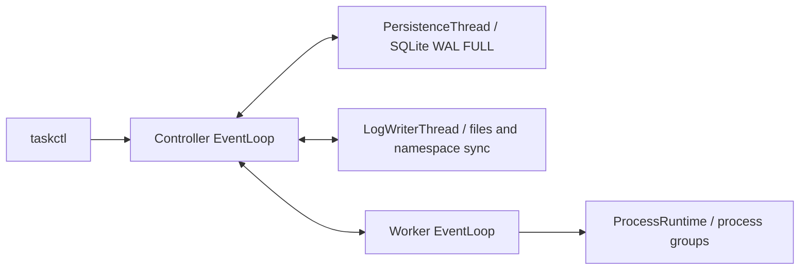

# Linux distributed task scheduler

A C++17/Linux learning project: one Controller, multiple Workers and `taskctl`.
Workers execute trusted executable/argv requests directly; the Controller places
tasks using advertised CPU/memory and deterministic projected dominant utilization.
SQLite stores metadata; a separate log writer stores binary stdout/stderr.

**Trusted operators/private networks only. There is no authentication, TLS,
sandbox or cgroup resource enforcement. Never expose the listeners publicly.**
Multiple Workers on one host share its physical resources.



## Build and test

Supported baseline: Ubuntu 22.04, GCC 11+, CMake 3.20+, Python 3.10+ for tooling.

```bash
sudo apt-get install build-essential cmake libsqlite3-dev libspdlog-dev \
  nlohmann-json3-dev libgtest-dev python3 pkg-config
cmake -S . -B "$HOME/build/task-scheduler" -DCMAKE_BUILD_TYPE=Debug
cmake --build "$HOME/build/task-scheduler" -j4
ctest --test-dir "$HOME/build/task-scheduler" --output-on-failure
```

Warnings are errors. Build outside the source tree. Do not delete a user's build
directory or `BUILD_COMMANDS.md` to obtain a clean build: use CMake's `clean` target.

## Install and run an isolated two-Worker demo

```bash
cmake -S . -B "$HOME/build/task-scheduler-runtime" -DBUILD_TESTING=OFF \
  -DCMAKE_BUILD_TYPE=Release -DCMAKE_INSTALL_PREFIX="$HOME/opt/task-scheduler"
cmake --build "$HOME/build/task-scheduler-runtime" -j4
cmake --install "$HOME/build/task-scheduler-runtime"
DEMO=$(mktemp -d /tmp/task-scheduler-demo.XXXXXX)
python3 "$HOME/opt/task-scheduler/share/task-scheduler/tools/local_cluster.py" demo \
  --bin-dir "$HOME/opt/task-scheduler/bin" --root "$DEMO" --workers 2
```

The demo verifies durable success, pending/active cancellation, timeout and manual
retry history; it stops only its own processes and keeps diagnostics/data. For
interactive use, replace `demo` with `start`, read `cluster.json` for the chosen
loopback client port, and use `status`/`stop --root "$DEMO"`. Use a new root for
each `demo`; `start` may reuse a stopped tool-owned root while preserving history.

## CLI

Global `--host`, `--port`, `--json` options precede the command.

```bash
taskctl --host 127.0.0.1 --port 7420 submit --cpu 1 --memory 16 --timeout 5 /bin/echo hello
taskctl get TASK_UUID
taskctl list
taskctl workers
taskctl logs TASK_UUID --attempt 1 --both
taskctl cancel TASK_UUID
taskctl retry TASK_UUID
```

`TASK_UUID` is the submit response. Task execution does not implicitly interpret
shell syntax. `--json` emits typed JSON; lists/logs emit one page per line.
`logs` fixes finite snapshots, automatically pages, and preserves arbitrary bytes.
`--both` concatenates stdout then stderr snapshots; it is not an interleaved or
live-follow stream.

## Guarantees and limits

- Durable submit precedes acceptance; durable assignment precedes RUN; committed
  cancel intent precedes active cancel acceptance/command.
- Active cancel is asynchronous: ACK is receipt, final termination is observed.
  First installed termination cause and frozen natural leader result win.
- Normal terminal visibility waits for reap/EOF, all log chunks, both file syncs,
  required directory syncs and the atomic Task/Attempt SQLite transaction.
- Session loss/restart yields LOST/FAILED, not proof of host death. Resource
  release/replacement follows the LOST commit. Worker reconnect follows cleanup.
- Retry is manual and FAILED-only; old Attempt/log history is immutable. Unknown
  remote execution may overlap a manual retry. No exactly-once claim is made.
- CPU/memory are accounting inputs. Logs have no retention/quota. Backpressure
  can block workload writes. Escaped setsid descendants and uninterruptible tasks
  have no finite termination guarantee. Local durability is not replication or
  cross-medium ACID.

## Navigation

These links use the source-checkout layout. Installed guide copies are flat files
under the GNUInstallDirs documentation directory; they do not include the source
tree or historical specification/report archive.

- [Operations and systemd](docs/OPERATIONS.md)
- [Development, tests and instrumentation](docs/DEVELOPMENT.md)
- [Implemented ownership/dataflow](docs/ARCHITECTURE_IMPLEMENTED.md)
- [Frozen architecture](docs/ARCHITECTURE.md), [protocol](docs/PROTOCOL.md),
  [failure model](docs/FAILURE_MODEL.md), [interview notes](docs/INTERVIEW_NOTES.md)
- [Reproducible benchmark](scripts/benchmark.py)
- Source: `include/ts`, `src/{controller,worker,runtime,storage,logs,net,io}`;
  tests: `tests/{unit,component,integration}`; tools: `scripts`; services: `packaging`.

M10 artifacts require independent review before merge, release or production deployment.
