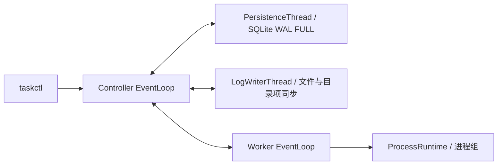

# Linux 分布式任务调度系统

[English](README.md) | [简体中文](README.zh-CN.md)

一个 C++17/Linux 学习与工程实践项目：单 Controller、多 Worker 和 `taskctl`。
Worker 直接执行可信的 executable/argv 请求；Controller 根据 Worker 广告的
CPU/内存容量，以确定性的预测主导资源利用率选择节点。SQLite 保存元数据，
独立日志线程保存二进制 stdout/stderr。

v1 已实现，面向可信的小规模 Linux 集群，用于编译测试、离线脚本等批处理命令，
支持取消、超时、手动重试和保守的故障恢复。它是工程原型，不是生产级集群平台。

**仅限可信用户与私有网络。没有身份认证、TLS、沙箱或 cgroup 资源强制隔离，
不要将监听端口暴露到公网。** 同一主机上的多个 Worker 共享物理资源。
监听地址默认为 `127.0.0.1`。多机使用前，需自行在 Worker 上准备可执行程序、
依赖和输入文件；项目不负责分发程序制品或同步数据。



## 构建与测试

支持基线：Ubuntu 22.04、GCC 11+、CMake 3.20+；工具脚本需要 Python 3.10+。
已记录的常规验证环境为 Ubuntu 22.04/WSL2、GCC 11.4、CMake 3.22.1；
TSan 使用独立的 GCC 12 工具链，详见开发文档。

```bash
sudo apt-get install build-essential cmake libsqlite3-dev libspdlog-dev \
  nlohmann-json3-dev libgtest-dev python3 pkg-config
cmake -S . -B "$HOME/build/task-scheduler" -DCMAKE_BUILD_TYPE=Debug
cmake --build "$HOME/build/task-scheduler" -j4
ctest --test-dir "$HOME/build/task-scheduler" --output-on-failure
```

编译警告按错误处理。请在源码目录之外构建；不要为了清理构建而删除用户的
构建目录或 `BUILD_COMMANDS.md`，使用 CMake 的 `clean` 目标。

## 安装并运行隔离的双 Worker 演示

```bash
cmake -S . -B "$HOME/build/task-scheduler-runtime" -DBUILD_TESTING=OFF \
  -DCMAKE_BUILD_TYPE=Release -DCMAKE_INSTALL_PREFIX="$HOME/opt/task-scheduler"
cmake --build "$HOME/build/task-scheduler-runtime" -j4
cmake --install "$HOME/build/task-scheduler-runtime"
DEMO=$(mktemp -d /tmp/task-scheduler-demo.XXXXXX)
python3 "$HOME/opt/task-scheduler/share/task-scheduler/tools/local_cluster.py" demo \
  --bin-dir "$HOME/opt/task-scheduler/bin" --root "$DEMO" --workers 2
```

演示验证持久化成功、PENDING/ACTIVE 取消、超时与手动重试历史；结束时只停止
自己启动的进程，并保留诊断文件和运行数据。交互使用时，将 `demo` 换成 `start`，
从 `cluster.json` 读取自动选择的 loopback 客户端端口，使用 `status` 或
`stop --root "$DEMO"` 查看和停止服务。每次 `demo` 使用新目录；`start` 可复用
已经停止、由工具管理的目录并保留历史。

## 命令行

全局选项 `--host`、`--port`、`--json` 放在命令之前。
以下示例使用默认 loopback 客户端端口 7420；若使用演示自动选择的端口，
每条命令都需要通过 `--port` 指定 `cluster.json` 中的值。

```bash
taskctl --host 127.0.0.1 --port 7420 submit --cpu 1 --memory 16 --timeout 5 /bin/echo hello
taskctl get TASK_UUID
taskctl list
taskctl workers
taskctl logs TASK_UUID --attempt 1 --both
taskctl cancel TASK_UUID
taskctl retry TASK_UUID
```

`TASK_UUID` 是提交响应中的任务 ID。任务命令不会隐式解释 shell 语法；
`--timeout` 的单位是秒。`--json` 输出结构化 JSON，在此模式下 list/logs
按页逐行输出。`logs` 固定有限快照并自动分页，保留任意二进制字节；
`--both` 先输出 stdout 快照，再输出 stderr 快照，不按两条流的时间顺序交错，
也不持续 follow。需要完整日志时先等待任务终态；二进制日志适合重定向到文件。

## 验证与测量

已记录的回归验证为 **473/473 项 CTest 通过**，覆盖协议分帧、fd/回调生命周期、
调度与资源记账、SQLite 回滚及提交顺序、真实进程执行、二进制日志、取消/超时、
重连和故障注入。这是特定环境下的验证记录，不表示所有主机和配置均已测试。

ASan/UBSan/LSan 验证和 GCC 12 TSan 覆盖见
[开发说明](docs/DEVELOPMENT.md)及 [M10 报告](docs/reports/MILESTONE_10_REPORT.md)。
TSan 覆盖 30 项组件测试与 3 项选定的真实 Controller/Worker 集成场景，
不是全量集成测试的 TSan 覆盖。现有自动化任务见
[Linux CI 工作流](.github/workflows/linux.yml)。

Post-v1 Release 测量使用 1/2/4 Worker、8 个独立提交客户端，负载为
`/bin/true`、`/bin/sleep 0.2` 或确定性二进制输出（stdout/stderr 各 32 KiB）。
**45 轮、5,400 个任务全部成功**，日志逐字节校验和最终资源释放均通过。
**60 个恢复样本**均满足预期的 LOST/FAILED、不完整日志、旧进程组清理及新 Session
检查；这些样本通过验证，不代表其中的工作负载成功执行。

| 测量场景 | 客户端/代理观察区间 | P95 |
| --- | --- | ---: |
| 4 Worker，二进制负载 | 提交请求开始 → 收到持久化提交响应 | 140.6 ms |
| 同上，每批 120 个任务 | 提交请求开始 → 首次观察到持久化终态 | 2013.7 ms |
| Worker TCP 断连 | 故障注入 → 首次观察到 LOST/FAILED | 11.1 ms |
| 同上，自动重连 | 故障注入 → 首次观察到新 HEALTHY Session | 121.8 ms |

并发场景统计来自 5 轮各 120 个任务，共 600 个样本；断连场景为 20 个样本。
完成时延包含任务排队和轮询延迟，**不是调度器内部耗时或数据库精确提交时间**。
重连使用 100 ms 初始退避，不会重试旧 Attempt。另测的心跳丢弃场景采用
100/1500 ms 心跳间隔/离线阈值，不是默认的 3000/10000 ms。
环境为 WSL2、同机 loopback、ext4 数据目录，不能据此宣称跨物理机扩展性或生产 SLA。

[Post-v1 详细报告](https://github.com/nhzj121/task-scheduler/blob/c117663970f0e35d3fe560f3149853db27e7bbd9/docs/benchmarks/POST_V1_BENCHMARK_REPORT.md)
和[汇总证据](https://github.com/nhzj121/task-scheduler/tree/c117663970f0e35d3fe560f3149853db27e7bbd9/docs/benchmarks)
固定指向 `post-v1-benchmark-evidence` 的测量提交，包含全部重复测量、精确命令、
原始数据位置和限制说明。

## 保证与限制

- 提交接受前先持久化；下发 RUN 前先持久化分配；ACTIVE 取消接受和命令发送前，
  先提交取消意图。
- ACTIVE 取消是异步的：ACK 仅表示收到请求，最终终止仍需观察确认。
  首先安装的终止原因与已冻结的 leader 自然退出结果遵守既定优先规则。
- 正常终态可见前，需完成子进程回收、输出 EOF、全部日志块处理、两条流的文件同步、
  必要的目录同步及 Task/Attempt 的原子 SQLite 终态事务。
- Session 丢失或重启恢复可能产生 LOST/FAILED，这不能证明物理主机死亡。
  资源释放与替换 Session 激活在 LOST 提交后进行；Worker 清理旧执行后才重连。
- 仅允许手动重试 FAILED Task，保留原 Attempt/日志历史。结果不确定的旧远端执行
  可能与手动重试重叠，不保证 exactly-once。
- CPU/内存是调度记账输入。日志没有自动保留期或配额，背压可能阻塞任务输出。
  主动 setsid 逃逸的后代与不可中断睡眠进程没有有限时间内终止的保证。
  本地持久化不等于复制容灾或跨介质 ACID。

## 导航

以下链接面向源码仓库布局。安装后的指南是 GNUInstallDirs 文档目录下的平铺文件，
不包含源码树或完整历史规范/报告。

- [运维与 systemd](docs/OPERATIONS.md)
- [开发、测试与检测工具](docs/DEVELOPMENT.md)
- [已实现的所有权与数据流](docs/ARCHITECTURE_IMPLEMENTED.md)
- [冻结架构](docs/ARCHITECTURE.md)、[协议](docs/PROTOCOL.md)、
  [故障模型](docs/FAILURE_MODEL.md)、[面试笔记](docs/INTERVIEW_NOTES.md)
- [可复现基准脚本](scripts/benchmark.py)
- 源码：`include/ts`、`src/{controller,worker,runtime,storage,logs,net,io}`；
  测试：`tests/{unit,component,integration}`；工具：`scripts`；服务文件：`packaging`。

v1 完成与本地验证不构成生产部署认证。
