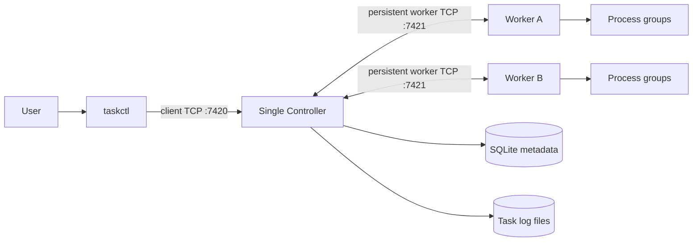
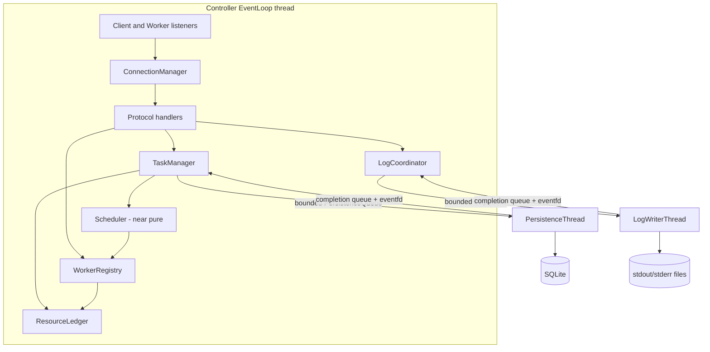
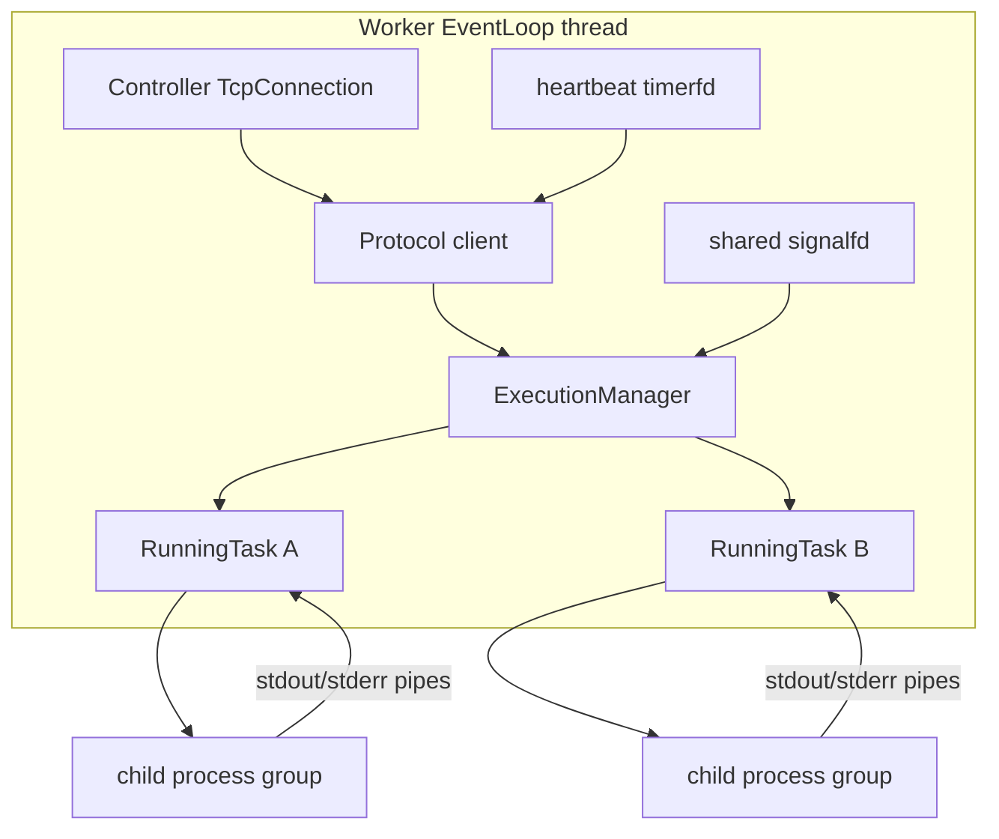
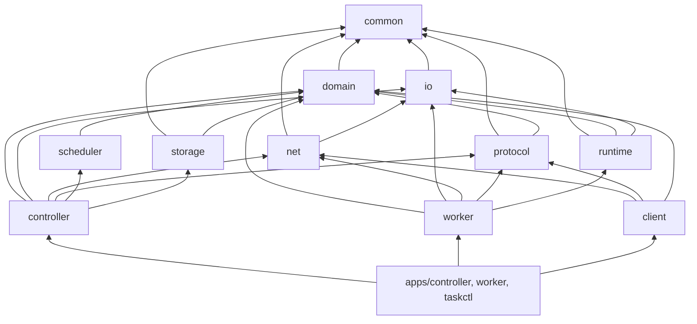
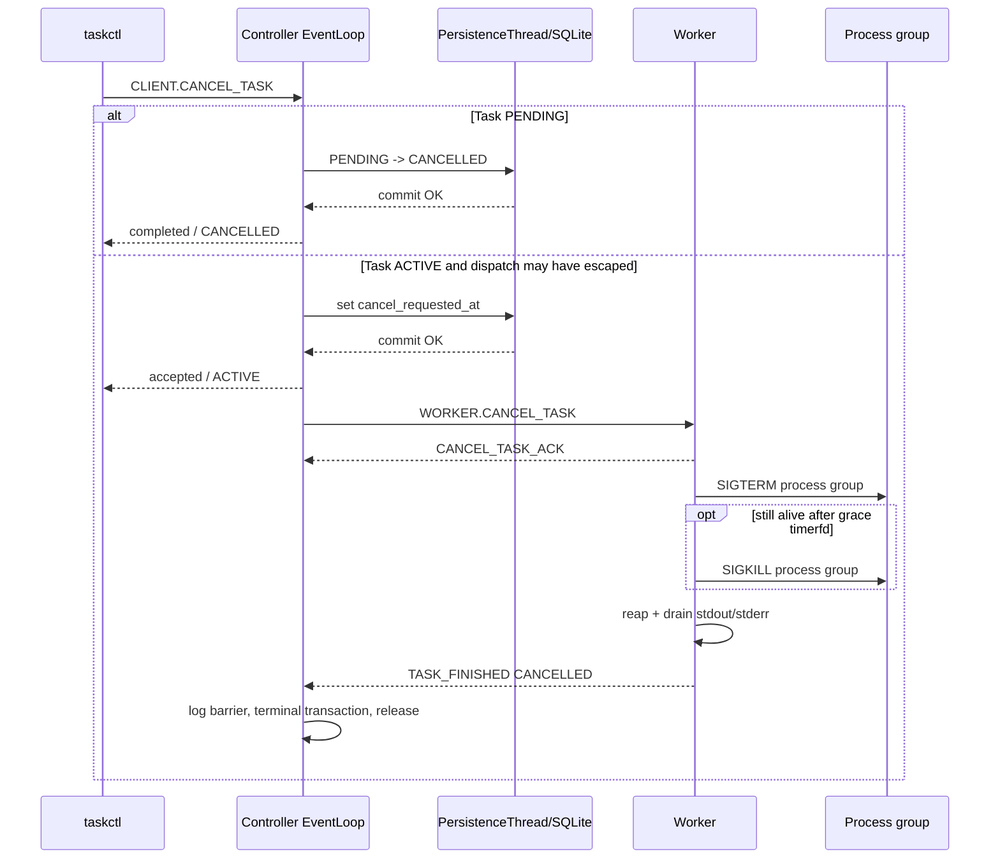
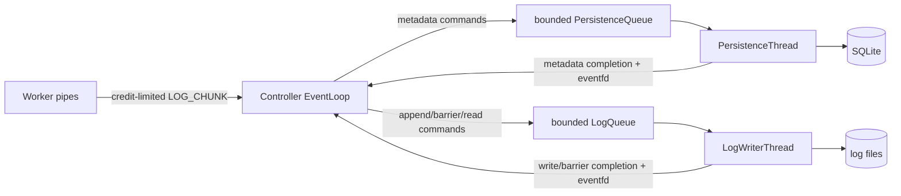

# Architecture

## System context

The v1 system is a small trusted-network workload manager: one Controller accepts CLI requests,
schedules Tasks onto multiple Workers, persists metadata in SQLite, and stores task output in
files. Workers execute direct executable/argv workloads as Linux process groups.



Ports are configurable examples. Default deployment binds both listeners to loopback. Multi-host
use must bind a trusted private interface; there is no TLS, authentication, authorization,
sandbox, or public-network safety.

## Architectural invariants

- The Controller EventLoop is the only writer of live Task, Attempt, Worker, WorkerSession,
  Connection, and resource-accounting state.
- `PersistenceThread` exclusively owns SQLite. `LogWriterThread` exclusively owns task-log
  filesystem operations, including directory/file creation, open file and directory fds, data
  I/O, and file/directory synchronization. They use separate bounded queues and never call each
  other.
- A durable control-plane transition precedes the irreversible network side effect it authorizes.
- Scheduler is a deterministic decision function and owns no state.
- EventLoop owns registrations, not registered objects. Owners unregister before fd destruction.
- A Task is user intent; an Attempt is one execution. A Worker identity, WorkerSession, and TCP
  Connection have separate lifetimes.
- No production C++ implementation is part of this architecture phase.

## Controller architecture



### Controller components

| Component | Responsibility | Must not do |
|---|---|---|
| `ConnectionManager` | Own listeners and `TcpConnection`s; apply transport close/error lifecycle | Domain transitions or SQLite |
| Protocol handlers | Decode role-valid messages and convert them to typed commands/events | Own domain state |
| `TaskManager` | Own mutable Task/Attempt records, transition serialization, retry/cancel, and persistence intents | Socket syscalls, process execution |
| `WorkerRegistry` | Own Worker records and current WorkerSessions; liveness and replacement | Persist fake live leases |
| `ResourceLedger` | Tentative/committed CPU, memory, and concurrency reservations | Measure/enforce OS resource use |
| `Scheduler` | Filter and rank immutable Worker snapshots | Own/send/persist/fork anything |
| `LogCoordinator` + EventLoop `LogCreditLedger` | Validate chunk order, own byte/slot credit reservations, correlate writes, drive final durability barrier and snapshot reads | Perform file I/O itself |
| `PersistenceThread` | Execute prepared SQLite transactions serially | Mutate EventLoop objects or write task logs |
| `LogWriterThread` | Create the task-log namespace, append/read log files, and execute final file-data plus directory-namespace durability barriers | Use SQLite or decide Task state |

### Controller concurrency and handoff

The EventLoop never waits on a condition variable or disk operation. It creates command values
containing copied immutable data and stable IDs, then uses `try_push` on a bounded queue.
Persistence completion and log completion values contain operation ID, entity ID, generation,
and result. A completion producer pushes into a thread-safe completion queue and writes its
`eventfd`; the EventLoop drains the fd and completion queue to `EAGAIN`.

Each Task permits one metadata transition in flight. Later events are queued by value and
revalidated after the commit. This handles `TASK_STARTED` arriving while the `STARTING`
transaction is still pending without allowing out-of-order persistence. Session generations
reject late completions belonging to an invalidated connection.

Backpressure is explicit:

- near PersistenceQueue high water, stop scheduling and reject new mutating client requests with
  `TEMPORARILY_UNAVAILABLE`; essential terminal/recovery commands have reserved capacity;
- inability to enqueue an essential metadata transition is a persistence availability fault and
  triggers fail-stop handling;
- granting log credit reserves exact raw-byte capacity and one command slot per granted chunk in
  advance; a valid credited `LOG_CHUNK` transfers both reservations into LogQueue/in-flight
  ownership and cannot encounter ordinary admission backpressure;
- failure to admit a correctly credited chunk is an internal invariant violation and triggers
  explicit Controller fail-stop rather than socket-read suspension;
- a non-grantable LogQueue command-slot reserve is kept for essential finalization barriers and
  completions; snapshot reads are lower priority/rejectable and cannot consume this reserve.

There is no general thread pool.

## Worker architecture



One thread handles the Controller socket, stdout/stderr pipes, per-task timeout/grace timerfds,
the Worker heartbeat timerfd, and one shared signalfd. Child processes provide execution
concurrency; no task thread pool exists.

`ExecutionManager` owns `RunningTask`s keyed by `attempt_id`. Each RunningTask owns its process
metadata and local fds. The Worker blocks `SIGCHLD` before creating threads/children and reads it
through signalfd. On notification it calls `waitpid(-1, ..., WNOHANG)` until no reapable direct
child remains and routes each pid to its owner.

The direct child is the workload leader. A natural leader exit records the workload outcome
immediately. If `kill(-pgid, 0)` indicates remaining members in the same workload process group,
Worker initiates cleanup with SIGTERM, the configured grace timer, and SIGKILL if required. Those
cleanup signals never replace the stored leader exit code/signal. Completion continues only after
same-group cleanup and stdout/stderr EOF. A descendant that deliberately leaves the group remains
outside the v1 guarantee and can delay EOF if it keeps an inherited pipe open.

On Controller connection loss the Worker stops launching, explicitly terminates all live process
groups, drains/reaps them, discards reports that can no longer be delivered, then reconnects with
a new `session_id`. It never claims continuity across sessions.

### Pre-fork execution preparation

All fallible C++ data construction and executable lookup happens in the Worker parent before
`fork`:

1. Snapshot the Worker environment into a key/value map (last inherited duplicate wins), then apply
   Task overrides (Task value wins). Keys are nonempty, contain neither `=` nor NUL, and values
   contain no NUL. Emit merged `KEY=VALUE` entries in lexicographic key order for deterministic
   envp; the value of `PATH` in this final map is authoritative.
2. Worker captures an absolute startup cwd at process start. Resolve a null Task cwd to that
   directory, an absolute Task cwd directly, and a relative Task cwd against startup cwd. Parent
   opens the resulting directory with `O_RDONLY|O_DIRECTORY|O_CLOEXEC` and opens `/dev/null` for child
   stdin; failure ends preparation.
3. Finalize owned `std::string` storage for submitted executable, argv (`argv[0]` is the submitted
   executable token and submitted args follow), merged environment entries, and any resolved
   executable path.
4. Only after string storage is stable, build null-terminated `char* const` argv/envp pointer
   arrays. They remain valid through the fork/exec attempt.
5. If executable contains `/`, pass that submitted path directly to `execve`; a relative path is
   interpreted after applying the prepared cwd. Otherwise require `PATH` in the merged environment,
   split it on `:` while preserving empty elements, and resolve in the parent. An empty element is
   the prepared execution cwd; a relative element is joined to that cwd; an absolute element is
   used directly. Append the executable token and select the first candidate that is not a
   directory and is executable under the Worker's effective credentials (`faccessat`/equivalent
   `X_OK` check). Retain that absolute candidate path. No candidate or missing PATH is a pre-fork
   launch preparation failure.

This lookup has the ordinary path check/`execve` TOCTOU limitation of a trusted environment; v1
does not add `fexecve` or a file-staging model. After fork, the child constructs no C++ container,
does no PATH/environment transformation, logging, heap allocation, or exception handling. It only
performs the documented async-signal-safe setup: close unused ends, `setpgid`, `dup2`, `fchdir` to
the prepared directory, restore the prepared signal mask, close redundant fds, and
`execve(prepared_path, argv,
envp)`. On failure it writes fixed stage/errno data to the exec-status pipe and calls `_exit`.

### Worker wire-output ordering

TcpConnection may prioritize heartbeat, ACK, and unrelated control frames over queued log frames
at frame boundaries. Each generated stdout/stderr `LOG_CHUNK` also receives an internal monotonic
per-Attempt emission ordinal across both streams. Generating `TASK_FINISHED` captures the last such
ordinal and creates a send dependency. The finish frame is not eligible for its first `send` until
every prior same-Attempt log frame is completely sent, including any frame previously stopped by a
partial write. Other Attempt logs do not block it. Thus priority cannot violate the per-Attempt
barrier while heartbeats remain eligible.

## taskctl architecture

`taskctl` is a thin single-threaded application over the reusable `client` library. The library
handles connect, framing, one request/response correlation, errors, task-list pagination, and log
snapshot pagination. The CLI handles arguments and human-readable/JSON output. A client disconnect
has no effect on submitted Tasks.

## Module dependency direction



`common` contains generic utilities only. `domain` has no I/O. `io` knows fds and callbacks but
not TCP or Tasks. `net` transports bytes and owns buffers but not framing semantics. `protocol`
encodes/decodes bytes but performs no socket I/O. `storage` executes requested transactions but
does not decide transitions. Application modules compose lower modules; dependencies never point
back upward.

## Submission-to-completion sequence

```mermaid
sequenceDiagram
    participant CLI as taskctl
    participant EL as Controller EventLoop
    participant DB as PersistenceThread/SQLite
    participant W as Worker EventLoop
    participant L as LogWriterThread
    participant P as Child process group

    CLI->>EL: CLIENT.SUBMIT_TASK
    EL->>EL: known single-Worker total-capacity admission (accepted path)
    EL->>DB: insert Task PENDING
    DB-->>EL: commit OK
    EL-->>CLI: SUBMIT_TASK_RESPONSE
    EL->>EL: select Worker; make tentative reservation
    EL->>DB: Task ACTIVE + Attempt ASSIGNED + binding
    DB-->>EL: commit OK
    EL->>EL: reservation becomes committed
    EL->>W: WORKER.RUN_TASK
    W-->>EL: RUN_TASK_ACK accepted
    EL->>DB: Attempt STARTING
    W->>P: pipe/fork/setpgid/dup2/exec
    W-->>EL: TASK_STARTED
    EL->>DB: Attempt RUNNING
    loop output with credit
      P-->>W: stdout/stderr bytes
      W-->>EL: LOG_CHUNK
      EL->>L: append
      L-->>EL: write complete
      EL-->>W: LOG_WINDOW_UPDATE
    end
    P-->>W: workload leader exit; record outcome
    opt same-pgid descendants remain
      W->>P: SIGTERM, grace, then SIGKILL if needed
    end
    P-->>W: group cleanup and stdout/stderr EOF
    W->>W: finish waits behind all prior same-Attempt LOG_CHUNK bytes
    W-->>EL: TASK_FINISHED with final counts
    EL->>L: final barrier after all writes
    L->>L: fdatasync stdout + stderr
    L->>L: fsync dirty containing directories
    L-->>EL: barrier OK
    EL->>DB: atomic Attempt + Task terminal transaction
    DB-->>EL: commit OK
    EL->>EL: release reservation; expose terminal
```

If an assignment transaction fails, the tentative reservation is rolled back and no `RUN_TASK`
is queued. If the session becomes stale while that transaction is pending, no dispatch is sent;
after assignment commit the Attempt is conservatively terminalized `LOST` in a follow-up
transaction, consistent with old-session invalidation.

## Cancellation sequence



If the Attempt is `ASSIGNED` and no `RUN_TASK` byte has entered the connection output path, the
Controller atomically terminalizes it locally and sends no command. Once any dispatch byte is
queued or sent, execution is treated as possible.

## Worker failure and reconnect sequence

```mermaid
sequenceDiagram
    participant W as Worker/old session
    participant EL as Controller EventLoop
    participant DB as PersistenceThread/SQLite
    participant NW as Worker/new session

    W--xEL: TCP loss or heartbeat deadline
    EL->>EL: invalidate session; stop placement
    EL->>DB: all old nonterminal Attempts LOST; Tasks FAILED
    DB-->>EL: atomic commit OK
    EL->>EL: release all old reservations; Worker OFFLINE
    EL--xW: close old connection if it is still open
    W->>W: on detected loss, terminate/reap local groups
    NW->>EL: REGISTER_WORKER with fresh session_id
    EL->>EL: verify old invalidation complete
    EL-->>NW: REGISTER_ACK; Worker HEALTHY
```

A replacement registration while the old socket is still open performs the same invalidation
and closes the old connection. There is no adoption of old processes or automatic retry.

## Controller restart

Startup proceeds before listeners accept work:

1. Open SQLite, validate schema version, and acquire exclusive process ownership of the data
   directory.
2. In one recovery transaction, change every nonterminal Attempt (`ASSIGNED`, `STARTING`, or
   `RUNNING`) to `LOST`, change its `ACTIVE` Task to `FAILED`, set recovery reason/timestamp, and
   set `logs_complete=false`; an uncommitted barrier/result is not inferred as complete.
3. Leave `PENDING` Tasks unchanged; retain every terminal Task and Attempt.
4. Load Tasks/Attempts and rebuild the pending scheduling order. Resource reservations start at
   zero because no old session is trusted.
5. Start EventLoop listeners and accept new Worker sessions. Workers must use new session IDs.

Workers detecting the old Controller connection loss terminate their workloads. The new
Controller does not query, adopt, or reconcile them. A process may run briefly during failure
detection, so no exactly-once claim is made.

## Control-plane persistence versus task-log data path



The paths are intentionally separate:

- **Control plane:** small transactional Task/Attempt metadata, cancellation intent, recovery,
  and queries. SQLite determines durable state visibility.
- **Log data path:** potentially high-volume binary stdout/stderr, base64 only on the network,
  append-only files on disk, and snapshot reads. SQLite stores paths, sizes, final sequences, and
  the `logs_complete` flag, never log bodies.

For each stream, Controller validates the next sequence, byte offset, and remaining session credit.
Global LogQueue capacity is partitioned in two dimensions: raw bytes and command slots, each free,
outstanding-granted, or queued/in flight at LogWriter. A received chunk consumes `raw_size` bytes
and one slot by transferring existing reservations; it does not allocate new queue capacity.
LogWriter completion frees both, advances `visible_bytes`, and permits a later credit grant. Unused
credit is reclaimed on session invalidation. Normal
backpressure therefore happens before Worker transmission: Controller capacity determines credit,
credit determines Worker pipe-read interest, and full pipes may block the workload. Controller
continues reading the Worker socket for heartbeats and control traffic.

Only grantable log-write slots enter Worker credit. A small separate command-slot reserve is never
granted and is available to essential finalization barriers; snapshot reads are refused or delayed
before consuming that reserve.

Failure to enqueue a schema-valid, in-sequence chunk within granted credit proves an internal
capacity-accounting invariant violation. Controller does not drop it or suspend reads as a normal
flow-control response; it enters the documented fail-stop path.

Because Worker `TASK_FINISHED` cannot overtake earlier same-Attempt chunks on the wire,
`LogCoordinator` has already accepted every declared chunk when it processes finish. Accepted
sequence/byte counters must immediately match the declaration or the session has violated the
protocol. For a valid finish, Controller waits only for those accepted writes to complete, then
places a barrier after them.

`LogWriterThread` is also the sole owner of task-log namespace mutation. Creating a task/attempt
directory with `mkdir` marks its containing directory namespace-dirty; creating stdout or stderr
with `O_CREAT` marks the log file's containing directory namespace-dirty. Directory fds are opened
and retained or reopened safely beneath the configured log root. The final barrier succeeds only
after both files complete `fdatasync` and every namespace-dirty containing directory required for
those files has completed `fsync`, deepest directory first through the log root. A directory that
was already synchronized successfully and has had no later namespace change need not be synced
again. Directory `fsync` is a creation/namespace operation and is not performed for ordinary log
chunks. This is a trusted-local-filesystem contract; v1 adds no storage service or replication.

Only after the complete file-data and directory-namespace barrier succeeds may the terminal
metadata transaction store final counters and `logs_complete=true`. A required directory `fsync`
failure is the same class of log-persistence failure as open, write, or `fdatasync` failure.

If the final barrier fails but SQLite remains usable, Controller commits Attempt `FAILED`, Task
`FAILED`, reason `LOG_PERSISTENCE_ERROR`, observed child result, and `logs_complete=false`.
Ordinary snapshot reads never claim more than LogWriter-reported `visible_bytes`.

Two terminal paths can prove that workload execution never began: explicit
`RUN_TASK_ACK.accepted=false` and local cancellation before any dispatch byte is queued. They store
zero sizes/final sequences with `logs_complete=true` without a data barrier; `GET_LOGS` treats a
missing zero-length file as the proven-empty stream. This shortcut requires that no failed
task-log namespace creation or required directory synchronization exists for the Attempt; the
normal implementation avoids creating its log paths at all. A `LOST` Attempt can never use this
shortcut.

## Persistence schema

Schema version 1 uses foreign keys and `CHECK` constraints. JSON text is canonicalized on write.

### `tasks`

| Column | Type/constraint |
|---|---|
| `task_id` | TEXT PRIMARY KEY |
| `state` | TEXT NOT NULL CHECK in the five Task states |
| `state_version` | INTEGER NOT NULL, monotonically incremented |
| `executable` | TEXT NOT NULL |
| `args_json`, `env_json` | TEXT NOT NULL |
| `cwd` | TEXT NULL |
| `cpu_slots` | INTEGER NOT NULL CHECK >= 1 |
| `memory_mb` | INTEGER NOT NULL CHECK >= 0 |
| `timeout_ms` | INTEGER NULL CHECK > 0 when present |
| `cancel_requested_at` | TEXT NULL |
| `latest_attempt_id` | TEXT NULL |
| `created_at`, `updated_at` | TEXT NOT NULL |

Indexes: `(state, created_at, task_id)` for scheduling and `(created_at DESC, task_id DESC)` for
listing.

### `attempts`

| Column | Type/constraint |
|---|---|
| `attempt_id` | TEXT PRIMARY KEY |
| `task_id` | TEXT NOT NULL REFERENCES tasks |
| `attempt_no` | INTEGER NOT NULL CHECK >= 1 |
| `state` | TEXT NOT NULL CHECK in the eight Attempt states |
| `state_version` | INTEGER NOT NULL |
| `worker_id`, `session_id` | TEXT NOT NULL for assigned Attempts |
| `assigned_at`, `acknowledged_at`, `started_at`, `finished_at` | TEXT NULL as lifecycle permits |
| `exit_code`, `term_signal` | INTEGER NULL |
| `reason` | TEXT NULL |
| `observed_outcome_json` | TEXT NULL, preserves child facts on infrastructure failure |
| `stdout_path`, `stderr_path` | TEXT NOT NULL |
| `stdout_bytes`, `stderr_bytes` | INTEGER NOT NULL DEFAULT 0 |
| `stdout_final_sequence`, `stderr_final_sequence` | INTEGER NULL |
| `logs_complete` | INTEGER NOT NULL DEFAULT 0 CHECK in (0,1) |

Constraints/indexes: `UNIQUE(task_id, attempt_no)`, index `(task_id, attempt_no)`, index
`(session_id, state)`, and index `(state)`. Application transactions enforce at most one
nonterminal Attempt per Task; tests also verify it.

### Transaction boundaries

| Operation | Single transaction contents |
|---|---|
| Submit | Insert one `PENDING` Task |
| Assignment | Conditional Task `PENDING -> ACTIVE` plus Attempt `ASSIGNED` insert/binding |
| Intermediate Attempt transition | Conditional Attempt update using `state_version` |
| Cancel intent | Conditional set of `cancel_requested_at` while Task remains `ACTIVE` |
| Terminalization | Conditional terminal Attempt update plus matching Task terminal update and final log metadata |
| Retry | Conditional Task `FAILED -> PENDING`, clear cancel intent, retain historical `latest_attempt_id`; Attempts untouched |
| Session loss | All bound nonterminal Attempts `-> LOST` and their Tasks `-> FAILED` atomically for that session |
| Startup recovery | All persisted nonterminal Attempts `-> LOST` and corresponding Tasks `-> FAILED` |

Prepared statements and `state_version` conditions make stale completions fail visibly. There is
no SQLite transaction around EventLoop memory: memory changes are applied in the documented order
after commit, and recovery derives truth from SQLite.

## Scheduling and resources

Pending Tasks are considered by `(created_at, task_id)` oldest first. A Worker is feasible only
when it is `HEALTHY`, the current session is valid, CPU and memory remaining cover the request,
and optional `max_concurrent_tasks` would not be exceeded. Scheduler minimizes projected dominant
utilization and uses lexicographic `worker_id` as final tie-break. Ratio comparisons are exact
rational comparisons with checked widened arithmetic, not rounded display percentages.

A scheduling pass scans the current pending order once. If the oldest Task has no feasible
Worker, it remains `PENDING` and the pass continues to later Tasks, avoiding cluster-wide
head-of-line blocking. This simple skip policy can starve a large request under a sustained stream
of smaller work; reservations, priorities, and anti-starvation are not v1 features. A new submit,
Worker becoming healthy, assignment rollback, or committed resource release schedules another
pass without a busy loop.

EventLoop creates a tentative reservation before submitting the assignment transaction so a
second scheduling pass cannot consume the same capacity. Failure rolls it back. Commit converts
it to a normal reservation. Terminal/session-loss commit precedes release. This ledger is
Controller memory state, not cross-medium ACID state and not cgroup enforcement.

## EventLoop rules

Approved post-v1 client admission is evaluated on the EventLoop before Submit
persistence and before a FAILED retry is issued. It uses last activated known
capacity, including OFFLINE advertisements, not available-resource scheduling
snapshots. Zero advertisements or no joint single-node fit returns the existing
error response without Task creation or retry mutation. It changes neither the
placement algorithm nor already accepted/recovered PENDING work; see ADR-024.
taskctl wait is client-side sequential GET_TASK polling with a monotonic
observation deadline; it adds no Controller thread, protocol event or persisted state.

- All sockets, pipe ends, signalfd, timerfds, and eventfds are non-blocking where applicable.
- LT callbacks drain reads, accepts, signals, timer counts, and completion queues until
  `EAGAIN`; writes progress until `EAGAIN`.
- `EPOLLOUT` is present only with pending output.
- A registration token contains fd plus monotonically increasing generation; callbacks resolve
  the token through the owning manager rather than capturing object pointers.
- Logical removal first marks the object closing, then `EPOLL_CTL_DEL`, then removes callbacks,
  then closes the owned fd and destroys the object after dispatch returns.
- Callbacks may enqueue deferred destruction so the current callback never deletes itself.

## Deliberate scale limits

The architecture targets a learning-scale cluster, not millions of nodes. One EventLoop, one
SQLite writer, one log writer, JSON/base64 logs, in-memory live state, and linear scans of modest
Worker sets are intentional. No HA, automatic retry, preemption, priorities, multi-tenancy,
container runtime, or hard resource enforcement is hidden in the design.
