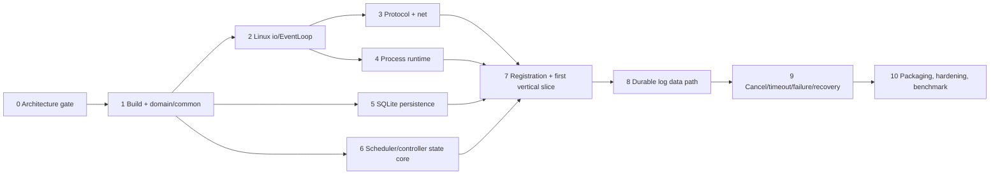

# Implementation Plan

This plan begins only after explicit approval of the architecture package. It names future source
work; it does not authorize production code in the current phase. Each milestone should be a
reviewable commit or small commit series with passing acceptance tests.

## Dependency order

## Milestone 0 — Architecture approval gate

**Outputs:** reviewed files under `docs/` only.

**Checks:** all items in `docs/spec/Architecture_Review_Checklist_v1.md`; identical states and
message IDs; no unresolved core decision; explicit human approval and review result recorded in
`docs/ARCHITECTURE_GATE.md`.

**Stop condition:** do not begin Milestone 1 without approval.

## Milestone 1 — Build baseline, common values, and domain rules

**Future modules:** top-level CMake, `common`, `domain`, test infrastructure; dependency discovery
for nlohmann/json, SQLite3, spdlog, GoogleTest.

**Work:** IDs/timestamps/result helpers, resource values, state enums and validated transition
functions, bounded queue value type, config value models. Do not add networking or processes.

**Acceptance:** state-table tests, invalid-transition tests, resource arithmetic/overflow tests,
config parsing tests; clean warning-as-error build.

**Suggested commits:** build/test skeleton; domain IDs/models; transition/resource/config tests.

**Checkpoint:** compare enum spelling and transition table to `STATE_MACHINE.md` before merging.

## Milestone 2 — Linux fd ownership and EventLoop

**Future modules:** `common/UniqueFd`, `io/epoll`, `io/EventLoop`, timerfd/signalfd/eventfd wrappers.

**Work:** move-only fd ownership, generation-safe registrations, LT readiness, deferred removal,
post/completion channel primitives.

**Acceptance:** ownership wrapper tests; add/modify/delete; stale fd generation; read/drain to
`EAGAIN`; write-interest toggling; timer/signal/event wakeups; no leak under repeated churn.

**Suggested commits:** UniqueFd; epoll registrations; EventLoop event sources; stress tests.

**Risk:** fd reuse and callback self-destruction. Resolve here before any connection/runtime owner
uses the loop.

## Milestone 3 — Frozen framing, protocol schemas, and TCP transport

**Future modules:** `protocol`, `net`, minimal loopback test helpers.

**Work:** exact 20-byte codec, all v1 typed JSON messages and validation, incremental frame parser,
bounded input/output queues, non-blocking listener/connect/accept/read/write, ConnectionManager.

**Acceptance:** golden header/message vectors; every split point; multiple frames/read; partial
send/EAGAIN; max-size/malformed/role-invalid rejection; callback lifetime and peer-close tests.

**Suggested commits:** header/parser; JSON schemas/message IDs; TcpConnection buffers; server/client
component tests.

**Checkpoint:** protocol IDs and examples must not be changed to suit implementation convenience.
A semantic change returns to architecture review.

## Milestone 4 — Standalone local process runtime

**Future modules:** `runtime`, Worker-side execution test harness only.

**Work:** parent-side merged environment/argv/envp/cwd/PATH preparation, pipe and `/dev/null`
setup, fork, minimal async-signal-safe child path, parent/child close discipline, process groups,
direct prepared-path `execve` and exec-status pipe, non-blocking capture, shared signalfd reap loop,
task/grace timerfds, natural-leader residual-group cleanup, and explicit termination.

**Acceptance:** complete runtime matrix: exit 0/nonzero/signal/exec failure, binary and large output,
rapid exit/tail drain, merged-PATH/slash executable resolution, exact argv/env, leader exit with a
same-pgid descendant holding pipes, preserved leader outcome, timeout, cooperative/uncooperative
cancel, process tree kill, no direct-child zombies or fd growth.

**Suggested commits:** spawn/exec status; EventLoop pipe capture/reap; timeout/cancel; stress tests.

**Risk:** only async-signal-safe child code between fork and exec. Review child path separately.

## Milestone 5 — SQLite StateStore and persistence channel

**Future modules:** `storage`, PersistenceThread integration utility.

**Work:** schema version 1, prepared statements, all transaction commands, state-version checks,
startup recovery, bounded command/completion channel. No Controller networking yet.

**Acceptance:** CRUD/constraint tests; atomic terminal/session-loss/recovery; rollback failpoints;
stale generation; queue bounds; SQLite error produces explicit failure.

**Suggested commits:** schema/migration; transaction commands; owner thread/channel; recovery/fault
tests.

**Checkpoint:** inspect actual schema against the table and recovery rules in `ARCHITECTURE.md`.

## Milestone 6 — Pure scheduler and Controller state orchestration

**Future modules:** `scheduler`, Controller `TaskManager`, `WorkerRegistry`, `ResourceLedger` using
fake persistence and transport ports.

**Work:** deterministic placement; tentative/committed reservations; one-transition-in-flight
serialization; cancellation intent; session invalidation; durable-side-effect gates represented
as interfaces.

**Acceptance:** scheduler vectors; reserve/rollback/release; transition completion reordering;
stale session; assert fake transport receives no RUN/CANCEL/response before fake commit; bulk LOST.

**Suggested commits:** scheduler; ledger; TaskManager persistence state machine; WorkerRegistry and
gating tests.

**Risk:** accidental mixing of persisted domain state and pending orchestration phase. Keep pending
operations separate from the frozen enums.

## Milestone 7 — Registration and first real vertical slice

**Future modules:** `controller`, `worker`, `client`, minimal `apps/controller`, `apps/worker`, and
`apps/taskctl` composition.

**Work:** listeners, connection roles, Worker registration/heartbeat, submit/status/list/workers,
scheduling, durable assignment, RUN/ACK/START/FINISH, Worker ExecutionManager, basic terminal
metadata. During this milestone, small-output capture may use the real protocol but terminal
success is not declared complete until Milestone 8 adds the required log barrier; tests should
not weaken that contract.

**Acceptance:** real Controller + Worker registers; durable submit; deterministic placement;
simple no-output `/bin/true` runs through all states; process/Controller restart queries retain
metadata. A feature flag/test seam may hold terminal finalization pending rather than fake log
completeness.

**Suggested commits:** application composition; registration/heartbeat; submit/schedule/dispatch;
first end-to-end no-output Task.

**Checkpoint:** trace every external side effect to its preceding successful transaction.

## Milestone 8 — Lossless durable task-log path

**Future modules:** Controller `LogCoordinator`/LogWriterThread, Worker log credit/priority buffers,
client log snapshots.

**Work:** binary chunk/base64, independent stream sequences, global/session pre-reserved credit,
bounded LogQueue, invariant-failure handling, LogWriter-owned namespace creation and directory
fds, file append completions, fixed-end snapshot paging, per-Attempt `TASK_FINISHED` wire
dependency across partial writes, final counts, two-file `fdatasync` plus required containing-
directory `fsync` barrier, terminal gating.

**Acceptance:** binary/large/interleaved logs exact; queue and TCP saturation bounded; granted
credit never exceeds reserved capacity; child writes backpressure before transmission; Controller
keeps reading heartbeats; finish never overtakes queued/partially sent same-Attempt logs; snapshot
stability; delayed barrier prevents terminal visibility; namespace creation syncs only dirty
containing directories rather than every chunk; write/file-sync/directory-sync fault never claims
complete logs; crash-order tests cover creation, file-data sync, directory sync, and terminal
metadata commit.

**Suggested commits:** LogWriter/paths; protocol credit; Worker pipe flow control; final barrier;
client snapshot pages; saturation/fault tests.

**Risk:** credit accounting must conserve both raw bytes and chunk slots across base64 expansion,
partial transmission, session loss, and write failure. Raw bytes, not encoded bytes, are the byte
credit unit.

## Milestone 9 — Cancellation, timeout, failure, reconnect, and recovery

**Future modules:** existing controller/worker/runtime/storage modules; fault harness.

**Work:** active cancel ACK/completion race, timeout, session loss, heartbeat/dispatch deadlines,
same-worker replacement, Worker cleanup-before-reconnect, Controller startup recovery,
persistence fail-stop, log-error terminalization, manual retry.

**Acceptance:** all cluster and fault scenarios in `TEST_STRATEGY.md`, especially reservation
release after commit, no auto retry, old Attempt history, process cleanup, and crash-order probes.

**Suggested commits:** cancel/timeout; liveness/session replacement; retry; restart recovery;
persistence/log fault policy; chaos tests.

**Checkpoint:** full architecture checklist review. No new recovery behavior may be invented here.

## Milestone 10 — Deployment, hardening, documentation, benchmark

**Future artifacts:** final README, example configs/workloads, systemd units, start/stop/benchmark
scripts, packaging/install rules as approved.

**Work:** secure loopback defaults, data-directory checks/locking, signal-driven shutdown,
structured system logging, sanitizer CI presets, reproducible benchmark methodology, operator and
interview docs synchronized with actual behavior.

**Acceptance:** clean-machine build/run; systemd start/stop/restart; multi-Worker definition-of-done
scenario; full CTest labels; ASan/UBSan and practical TSan pass; bounded benchmark reports without
production claims.

**Suggested commits:** configs/systemd; scripts/examples; sanitizer/CI; benchmark; final docs audit.

## Cross-cutting review rules

- A milestone is not complete with TODO/fixed-value/mock core behavior. Test fakes remain in test
  code and validate real interfaces.
- No source module may reverse the dependency direction in `ARCHITECTURE.md`.
- New protocol fields/messages, states, or failure mappings require a documentation decision and
  architecture review before code.
- Every fd owner and cleanup order is reviewed when introduced, not deferred to hardening.
- Metrics/benchmark work measures current behavior; it does not add scheduling features.
- Vertical slices must preserve durable/log semantics even if they initially support only a
  narrow workload case.

## Principal implementation risks

| Risk | Planned containment |
|---|---|
| fd reuse/dangling callback | generation tokens, deferred destruction, Milestone 2 stress tests |
| fork/exec error ambiguity | close-on-exec status pipe and isolated child-path review |
| state event reordering around async DB | one transition in flight per Task, value queues, version checks |
| overcommit while assignment persists | tentative EventLoop reservation |
| terminal state racing log tail or newly created namespace | final sequence validation + LogWriter file-data/directory-namespace barrier |
| log memory explosion/control starvation | raw-byte + chunk-slot credit, bounded separate queue, control priority with finish dependency |
| session replacement race | session generation, old LOST commit before new ACK |
| SQLite error causing split brain | no gated side effect and fail-stop |
| scope/LOC expansion | no HA/security/containers/reconciliation; checkpoint against v1 non-goals |
