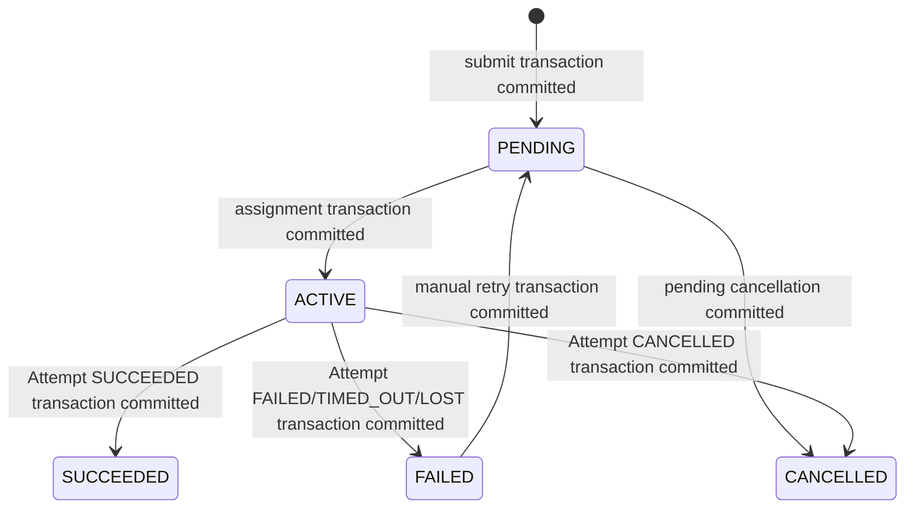
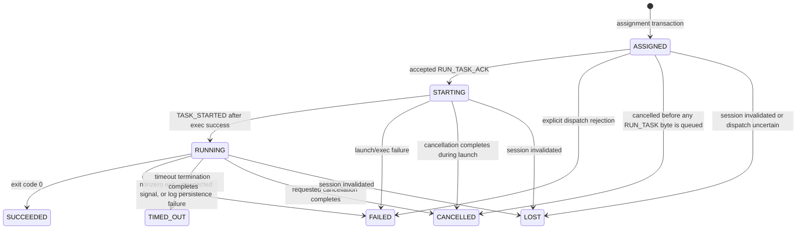
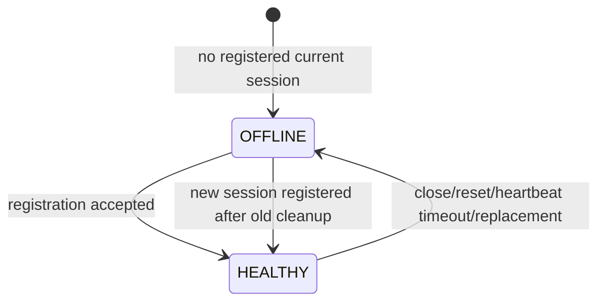

# State Machines

This document is the normative v1 state-transition contract. State names are uppercase and
must be used exactly as written in code, storage, protocol payloads, tests, and other documents.
Internal orchestration phases such as “persistence pending” or “finalizing logs” are not new
domain states and must not be exposed as such.

## Invariants

1. A Task and an Attempt are different records and lifetimes.
2. A Task has at most one nonterminal Attempt.
3. `PENDING` has no nonterminal Attempt. `ACTIVE` has exactly one nonterminal Attempt.
4. A terminal Attempt is never mutated into another state.
5. Manual retry changes only a `FAILED` Task to `PENDING`; it never changes old Attempts.
6. Task and Attempt terminal changes are committed in one SQLite transaction.
7. One Controller EventLoop thread owns transition decisions. Other threads report results by
   stable IDs and generation numbers.
8. A transition is externally visible only after its required persistence commit succeeds.

## Task state machine

Approved post-v1 client capacity admission is a prerequisite to new submit and
FAILED retry (ADR-024), before their persistent transitions. Rejection performs
no transition and does not retroactively re-admit or cancel existing PENDING
tasks. Task/Attempt states and all transition/commit-order rules below are unchanged.



### Task transition table

| From | To | Trigger | Sole decision owner | Required persistence and side-effect order |
|---|---|---|---|---|
| none | `PENDING` | Valid `CLIENT.SUBMIT_TASK` | Controller `TaskManager` | Insert Task and commit; then return submit success and make it schedulable. |
| `PENDING` | `ACTIVE` | Scheduler selects a current healthy session | Controller `TaskManager` | In one transaction update Task and insert Attempt `ASSIGNED` with binding. Commit; convert tentative resource reservation to committed; then queue `RUN_TASK`. |
| `PENDING` | `CANCELLED` | Valid client cancellation | Controller `TaskManager` | Update and commit Task; then return completed cancellation. No Attempt is created. |
| `ACTIVE` | `SUCCEEDED` | Active Attempt is ready to become `SUCCEEDED` | Controller `TaskManager` | After log durability barrier, atomically commit Task+Attempt terminal state; release reservation; expose terminal state. |
| `ACTIVE` | `FAILED` | Active Attempt becomes `FAILED`, `TIMED_OUT`, or `LOST` | Controller `TaskManager` | Atomically commit Task+Attempt terminal state; for an observed process result first satisfy the log barrier; release reservation; expose terminal state. |
| `ACTIVE` | `CANCELLED` | Active Attempt becomes `CANCELLED` | Controller `TaskManager` | After final log barrier, atomically commit Task+Attempt terminal state; release reservation; expose terminal state. |
| `FAILED` | `PENDING` | Valid `CLIENT.RETRY_TASK` | Controller `TaskManager` | Update Task state and clear cancellation intent in one transaction; retain `latest_attempt_id` as historical reference and retain all Attempt rows; commit before responding. |

`cancel_requested_at` is orthogonal persisted intent, not a Task state. For an active Task, the
Controller commits this field before sending `WORKER.CANCEL_TASK`. The Task remains `ACTIVE`.
The first valid terminal event serialized by the EventLoop wins: cancellation does not rewrite a
success/failure that was already committed, and a later session loss yields `FAILED`, not a false
claim of successful cancellation.

## Attempt state machine



### Attempt transition table

| From | To | Trigger | Sole decision owner | Persistence rule |
|---|---|---|---|---|
| none | `ASSIGNED` | Placement selected and tentative resources reserved | Controller `TaskManager` | Insert with Task `PENDING -> ACTIVE` in one assignment transaction before dispatch. |
| `ASSIGNED` | `STARTING` | `RUN_TASK_ACK.accepted=true` for current session/request | Controller `TaskManager` | Commit Attempt transition before status exposes `STARTING`. Subsequent worker events are queued per Attempt while this commit is pending. |
| `ASSIGNED` | `FAILED` | Worker explicitly rejects before starting | Controller `TaskManager` | Atomically commit Attempt `FAILED` and Task `FAILED` with proven-empty logs (`0` bytes/sequences, `logs_complete=true`); release after commit. Reason is `DISPATCH_REJECTED`. |
| `ASSIGNED` | `CANCELLED` | Cancel arrives before any `RUN_TASK` byte has been placed in the connection output path | Controller `TaskManager` | Atomically commit Attempt and Task `CANCELLED` with proven-empty complete logs; release after commit; send no Worker command. |
| `ASSIGNED` | `LOST` | Bound session is invalidated, dispatch ACK times out, or send outcome is uncertain | Controller `TaskManager` (WorkerRegistry supplies the invalidation event) | Atomically commit Attempt `LOST` and Task `FAILED`; release after commit. |
| `STARTING` | `RUNNING` | Current Worker reports `TASK_STARTED` after successful exec confirmation | Controller `TaskManager` | Commit Attempt state and `started_at`; Task remains `ACTIVE`. |
| `STARTING` | `FAILED` | Worker reports pipe/fork/setup/`exec` failure | Controller `TaskManager` | After any emitted-log barrier, atomically commit Attempt `FAILED` and Task `FAILED`; retain errno/reason. |
| `STARTING` | `CANCELLED` | Worker completes requested termination before start is established | Controller `TaskManager` | Final log barrier, then atomic Task+Attempt terminal transaction. |
| `STARTING` | `LOST` | Bound session invalidated | Controller `TaskManager` (WorkerRegistry supplies the invalidation event) | Atomic Task+Attempt terminal transaction. Logs are not claimed complete. |
| `RUNNING` | `SUCCEEDED` | Reaped child exited 0 and final logs satisfy the durability barrier | Controller `TaskManager` | Atomic Task+Attempt terminal transaction after barrier. |
| `RUNNING` | `FAILED` | Reaped child exited nonzero or by unexpected signal; or final log persistence failed | Controller `TaskManager` | Atomic Task+Attempt terminal transaction. Ordinary process results wait for the barrier. `LOG_PERSISTENCE_ERROR` records `logs_complete=false`. |
| `RUNNING` | `TIMED_OUT` | Runtime timeout fired and process group termination/reaping completed | Controller `TaskManager` | Final log barrier, then atomic Task+Attempt terminal transaction; Task becomes `FAILED`. |
| `RUNNING` | `CANCELLED` | Requested process-group termination/reaping completed | Controller `TaskManager` | Final log barrier, then atomic Task+Attempt terminal transaction; Task becomes `CANCELLED`. |
| `RUNNING` | `LOST` | Bound session invalidated | Controller `TaskManager` (WorkerRegistry supplies the invalidation event) | Atomic Task+Attempt terminal transaction without a log-completeness claim. |

### Internal finalization phase

After a Worker reports process completion, the persisted Attempt normally remains `RUNNING` (or
`STARTING` for a launch failure) while the Controller performs these internal steps:

1. Validate `TASK_FINISHED` final sequence numbers and byte counts.
2. Wait until all preceding `LOG_CHUNK` commands have completed file writes.
3. Enqueue and complete a per-Attempt LogWriter barrier that calls `fdatasync` on both files and
   completes `fsync` for every containing directory made namespace-dirty by task/attempt directory
   or log-file creation. Directory sync is not performed per chunk.
4. Submit the terminal Task+Attempt SQLite transaction.
5. On commit, apply the terminal state in EventLoop memory, release resource reservation, and
   satisfy pending queries.

This phase is deliberately not a new Attempt state. Status continues to show the last committed
nonterminal state and may include `finalization_pending=true` as diagnostic metadata. It never
claims terminal state or complete logs early.

## Worker state machine



| From | To | Trigger | Owner | Persistence |
|---|---|---|---|---|
| none | `OFFLINE` | Controller has no valid session for `worker_id` | Controller `WorkerRegistry` | Memory-only. |
| `OFFLINE` | `HEALTHY` | Registration validated, any old-session LOST transaction committed, and `REGISTER_ACK` queued | Controller `WorkerRegistry` | Worker live state is not restored or stored as a lease in SQLite. |
| `HEALTHY` | `OFFLINE` | TCP close/reset, heartbeat deadline, protocol violation, explicit Controller shutdown, or replacement registration | Controller `WorkerRegistry` | All bound nonterminal Attempts and Tasks are terminalized in SQLite before their reservations are released. |

Heartbeat defaults are 3 seconds at the Worker and a 10-second offline deadline at the
Controller; both are configurable. `HEALTHY` means only that the current session is registered
and not past its liveness deadline. It is not proof that the host or workloads are healthy.

## Worker local execution phases

These phases are implementation lifecycle, not protocol/domain enums:

```text
ACCEPTED -> PREPARED -> LAUNCHING -> EXEC_CONFIRMED -> LEADER_REAPED
         -> GROUP_CLEANUP? -> DRAINED -> WIRE_BARRIER_SATISFIED -> REPORTED
```

- `RUN_TASK_ACK.accepted=true` is queued before launch begins.
- Parent-side merged environment, argv/envp, cwd resources, and executable resolution are complete
  before `fork`; the child does not construct or transform them.
- The exec-status pipe reports child setup/exec failure; close-on-exec EOF confirms exec.
- `TASK_STARTED` is queued before any buffered log chunks.
- A timeout or cancel records one termination cause; the first cause wins.
- On a natural workload-leader exit, its outcome is frozen; remaining same-pgid processes receive
  SIGTERM/grace/SIGKILL cleanup without changing that outcome.
- `TASK_FINISHED` is created only after leader reap, same-pgid cleanup, stdout/stderr EOF, and
  generation of every log chunk. It cannot begin sending until all earlier same-Attempt log frames
  are fully sent.
- A RunningTask is removed only after reporting is queued, all fds are unregistered/closed, and
  its child is reaped.

## Invalid transitions

The following are rejected rather than coerced:

- any transition out of `SUCCEEDED`, `CANCELLED`, or a terminal Attempt;
- Task `SUCCEEDED -> PENDING` or `CANCELLED -> PENDING` in v1;
- Task `PENDING -> SUCCEEDED/FAILED` without an Attempt;
- creation of a second nonterminal Attempt for an `ACTIVE` Task;
- Attempt `ASSIGNED -> RUNNING` without committed `STARTING`;
- Attempt `STARTING -> SUCCEEDED` without `RUNNING`;
- Attempt `RUNNING -> STARTING/ASSIGNED`;
- Attempt terminalization from an event belonging to a stale `session_id`;
- a `TASK_STARTED`, `LOG_CHUNK`, or `TASK_FINISHED` for an unknown or differently bound Attempt;
- retry while the Task is `PENDING`, `ACTIVE`, `SUCCEEDED`, or `CANCELLED`.

Role-valid but stale asynchronous Worker messages are logged and the connection is closed when
they imply session corruption. A duplicate client request is not automatically deduplicated in
v1; clients must not retry a timed-out submit as if it were known not to have committed.

## Persistence serialization

Each Task has at most one outstanding metadata transition. Events arriving while its transaction
is pending are queued by stable `task_id`/`attempt_id`, then revalidated against the newly
committed state. Persistence completions carry an operation generation, so a late completion
cannot mutate a replaced session or destroyed connection. No cross-thread closure owns a raw
pointer to Task, Attempt, WorkerSession, or TcpConnection.
